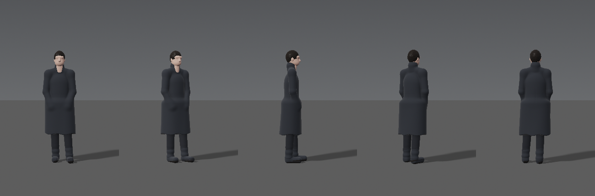
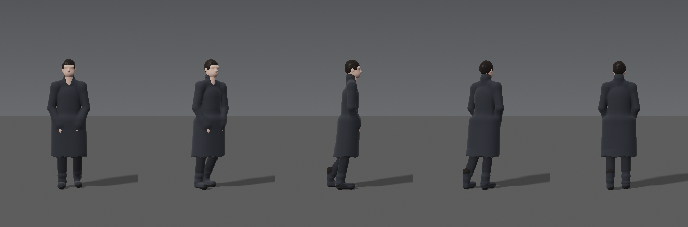

# Великий Океан — референс героя и Океана

Цель документа — непрерывность: герой и мир выглядят одинаково во всех 44 планах. Герой задан в коде (`src/engine/hero.py` — скелет, пропорции, походка; `src/engine/shaders/world.frag`, функция `sdHero` — форма и материалы). Поэтому он идентичен в каждом кадре по определению. Ниже — то, что нельзя менять без решения режиссёра.

*Турнараунд в нейтральном студийном свете (спереди, 3/4, профиль, 3/4 со спины, со спины). В фильме герой почти всегда в контровом лунном или солнечном свете, то есть силуэтом.*

## 1. Кто он

- Мужчина 35–45 лет, рост 1,82 м, сухощавое среднее телосложение.
- Внутреннее состояние: серьёзность, усталость, жажда возвращения — **без театрального страдания**.
- Подача: со спины, 3/4 со спины, профиль в контровом свете. **Лицо в фас крупным планом не показываем никогда.** Лицо существует как силуэт профиля с тонкой кромкой света.

## 2. Силуэт и костюм (ключи узнаваемости)

| Элемент | Решение | Числа в модели |
|---|---|---|
| Пальто | тёмное шерстяное, угольно-серое, до колена, лёгкий A-силуэт, центральный шов на спине | альбедо 0,028/0,030/0,034; подол 0,47 м от земли |
| Воротник | стойка, выше сзади, открыт у горла | радиус 0,069–0,073 м, высота +0,042 м над основанием шеи |
| Плечи | естественный наклон трапеций, без «подплечников» | ширина суставов ±0,181 м |
| Брюки | тёмные, прямые, лёгкий излом у щиколотки | альбедо 0,022/0,023/0,026 |
| Обувь | тёмные кожаные ботинки, без блеска | альбедо 0,018 |
| Волосы | короткие, тёмно-каштановые, почти чёрные, неровная кромка в контровом свете | альбедо 0,018/0,015/0,013 |
| Кожа | тёплая, в ночном свете почти не видна | альбедо 0,32/0,22/0,18 |
| Запрещено | шляпа, сумка, шарф контрастного цвета, логотипы, украшения, светлые детали | — |

## 3. Пропорции скелета (метры, герой смотрит вдоль +z)

таз 0,985 · грудь 1,30 · основание шеи 1,515 · центр головы 1,672 · плечевые суставы y = 1,432, x = ±0,181 · плечо 0,295 · предплечье 0,265 · кисть 0,17 · бедро 0,445 · голень 0,435 · высота щиколотки 0,085 · стопа 0,19 · тазобедренные суставы x = ±0,093

## 4. Пластика

- **Шаг:** медленный, ≈0,58 м/с, длина шага ≈0,41 м, лёгкий наклон корпуса вперёд 3–5°. Ступни планируются по шагам и не скользят. Таз покачивается и переносит вес на опорную ногу.
- **Стойка:** вес на правой ноге, левая чуть впереди и в сторону. Дыхание с периодом 4,6 с, плечи поднимаются на 3–4 мм. Голова едва заметно дрейфует.
- **Руки** — главный жест-сюжет фильма:

| Планы | Руки | Смысл |
|---|---|---|
| 02–05 | в карманах | закрытость, холод, отделённость |
| 06 | вынимает из карманов | первое открытие |
| 11–13 | тянется к воде, касается | просьба, контакт |
| 15–17 | снова в карманах | боль, откат назад |
| 26 | зачерпывает воду, она утекает | «по крупицам искать» |
| 31–33 | на коленях, ладони на воде | смирение |
| 37–41 | свободны, раскрыты вдоль тела, он идёт в воду | принятие, возвращение |

- Никаких заломанных рук, воздетых к небу ладоней, падений на колени с размаху. Каждое движение медленное и законченное.

## 5. Непрерывность состояния костюма

- До плана 12 пальто сухое.
- После наката в плане 13 намокают низ пальто и ботинки (тёмная влажная кромка).
- План 22 и далее: брюки мокрые до колена.
- Планы 31–37 (на коленях в воде): пальто мокрое до пояса, с подола стекает вода.
- Планы 38–41: он входит по пояс, затем глубже. Края силуэта распадаются на блики только в 40–41.

## 6. Океан как персонаж

- Океан не показывается «существом». Его голос — **свет и движение**: лунная дорожка, которая открывается на вход вокализа (план 03), кольца от касания (12–14), свечение из глубины (29–30), солнце на «дан» (34).
- Женский вокализ никогда не иллюстрируется певицей. Это ответ Океана, и на экране ему всегда соответствует изменение света или воды.
- Мощь Океана не разрушает: даже волна о скалы (16) снята в замедлении и без угрозы.

## 7. Ограничения текущей модели (честно)

- Голова собрана из простых форм: черты лица условные. Для силуэтов, профиля в контровом свете и общих планов этого достаточно. Для крупного плана профиля (план 32) голову и кисти перед продакшеном нужно доработать: детальнее нос, губы, веки, уши; пальцы для планов 12 и 26.
- Ткань не симулируется: складки и колыхание пальто процедурные (ветер, подол, ноги «толкают» полы). На крупных планах это видно как упрощение.
