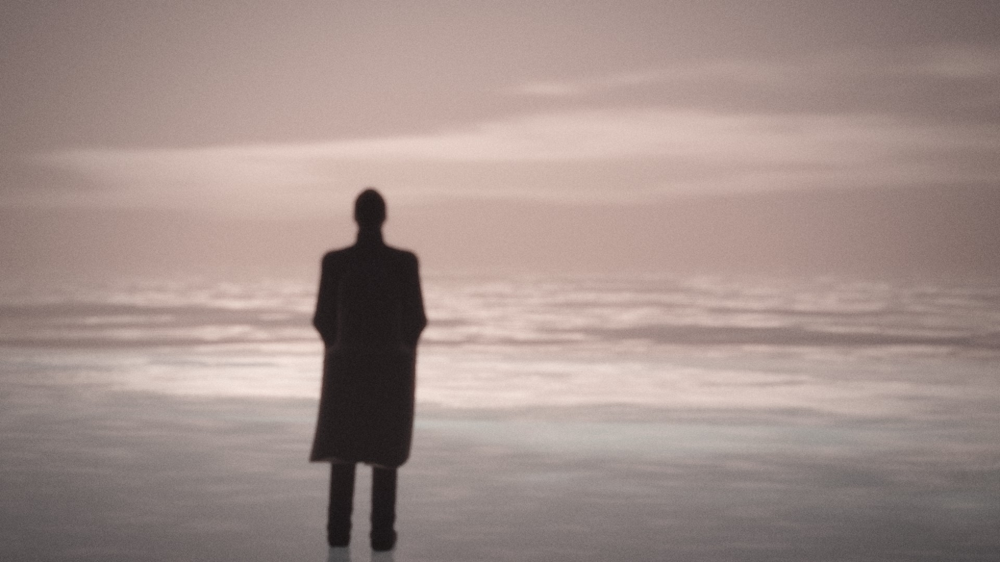
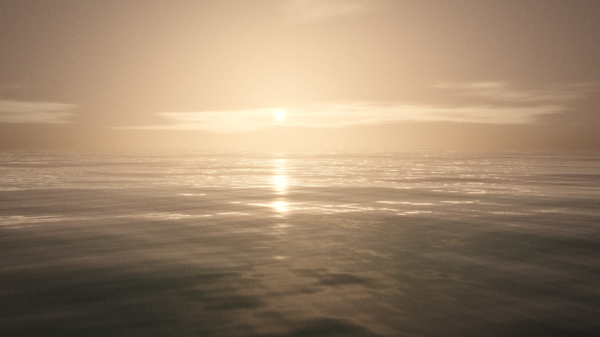
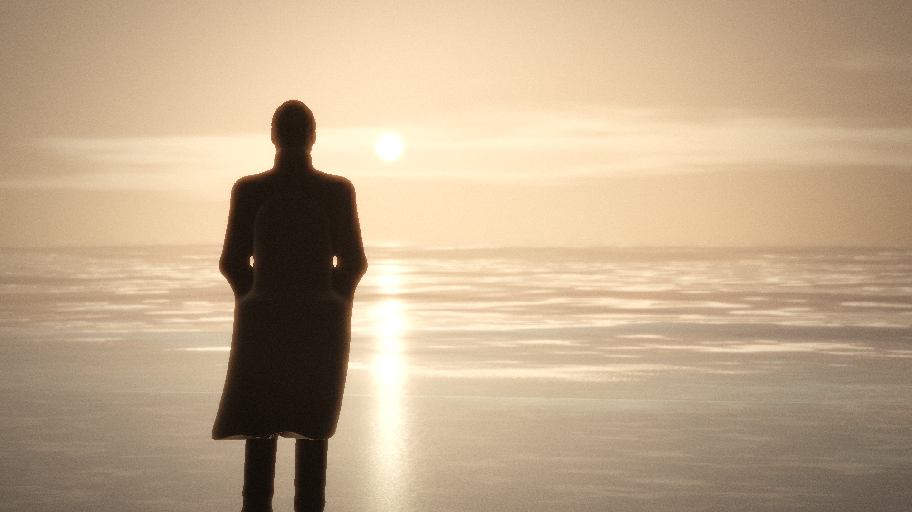

# Великий Океан — стиль-гайд

Документ фиксирует визуальный язык фильма, чтобы все 44 плана выглядели как одно произведение. Числа здесь совпадают с параметрами рендер-движка (`src/engine/scene.py`, `src/engine/shaders/*.glsl`). Если меняется число в коде, меняется и этот документ.

## 1. Жанр и честное определение изображения

- **Что это:** процедурная 3D-графика (raymarching на GLSL), отрисованная офлайн на CPU через Mesa llvmpipe. Каждый кадр вычисляется заново: волны по дисперсии глубокой воды, объёмный туман, физическая камера с ГРИП, фигура героя со скелетной анимацией.
- **Чем это не является:** это не фотореалистичная нейросетевая видеогенерация и не съёмка. Стиль — *кинематографический стилизованный реализм* («cinematic spiritual realism + subtle surrealism» из брифа), а не фотографическая подделка.
- **Почему так:** в окружении нет видео- и фото-моделей и нет API-ключей к ним (см. `ENVIRONMENT.md`). Процедурный путь даёт настоящую анимацию, а не зум по статичным картинкам. Он полностью наш по лицензиям, детерминирован и обеспечивает идеальную непрерывность героя и мира между планами.

## 2. Формат

| Параметр | Значение |
|---|---|
| Кадр | 16:9, 1920×1080, без шторок |
| Частота | 24 к/с (кадр = 41,667 мс), таймкоды от первого сэмпла MP3 |
| Звук | оригинальный MP3 без изменений (stream copy в MP4) |
| Кодек мастера | H.264 High, yuv420p, CRF 14, preset slow, tune grain |
| Длина | 8101 кадр = 337,54 с (аудио 337,52 с) |

## 3. Драматургия цвета и света

Свет — главный драматургический инструмент: Океан «отвечает» герою светом.

| Состояние | Планы | Ключ | Палитра (линейно → на экране) | Туман |
|---|---|---|---|---|
| **N1** Ночь, луна скрыта | 01–02 | луна за облачной грядой (видно гало) | свинцово-синий, чёрно-синие тени, зенит ≈ #0b1220 | сине-серый, плотность 0,008/м, приземные клочья |
| **N2** Ночь, луна открыта | 03–14 | луна, азимут −14°, высота 13°, холодное серебро (0,62 0,70 0,86) | сталь + серебро; лунная дорожка — единственный яркий элемент | контровое свечение вокруг луны (HG g = 0,65) |
| **N3** Ветер, базальт | 15–17 | луна сквозь бегущие облака | сталь, чёрный базальт, никакого тепла | рваный, быстрый дрейф |
| **N4** Просвет | 17–19 | дорожка ложится к герою | серебро на воде, глубокий синий | мягче |
| **D0** Предрассветная синева | 20–23 | рассеянный свет востока, луна низко | молочный голубовато-стальной | молочный, стирает горизонт |
| **D1** Синий час, зеркала | 24–28 | бестеневой свет неба | холодный пастельный синий, перламутр | почти нет, вода неподвижна |
| **D2** Жемчужный рассвет | 29–31 | свет изнутри тумана | жемчуг, розоватый пояс у горизонта | светится тёплым |
| **D3** Первый луч | 32–34 | край солнца сквозь туман | перламутр → мягкое золото | тает |
| **D4** Восход | 35–38 | низкое солнце | мягкое золото, бирюза в гребнях | слоями поднимается |
| **D5** Растворение | 39–44 | солнце над туманом | белое золото, без кислотной насыщенности | лучи в дымке |

**Правила палитры:**
- Насыщенность ночи 0,72, рассвета до 0,9. Ни одного «кислотного» цвета, никакого неона.
- Чёрная точка слегка приподнята, как на плёнке: lift (0,006 0,009 0,016) ночью и тёплый lift на рассвете.
- Тени ночью уходят в синий, света — в нейтральное серебро. На рассвете тени перламутровые, света — тёплые, но не оранжевые.
- Самое яркое пятно кадра — всегда свет Океана (луна, дорожка, кольцо света, солнце), а не фигура.

## 4. Камера и оптика

- **Физическая камера:** фокусное в мм на кадре 36 мм. Используем 24, 26, 28, 32, 35, 40, 50, 65, 85 и 100 мм (макро). Круг нерезкости считается по реальной формуле линзы (f/1,8–f/4).
- **Движение:** медленное и мотивированное: наезды, боковые треки, краны, редкие аэро- и верхние планы. Скорость наезда не больше ≈0,6 м/с, кран не больше ≈1 м/с.
- **«Дыхание» штатива:** микро-дрейф 6 мм / 0,07° на очень низких частотах, как на флюид-голове. Никакой имитации тряски.
- **Запрещено:** «дешёвый» зум по статичной картинке, быстрые whip-pan, dutch-angle больше 1°.
- **Монтаж:** склейка на долю или на начало вокальной фразы (таблица в `STORYBOARD.md`). Наплывы только на смене акта (20) и на пустом отражении → горизонт (29). Затемнение только в начале (проявление 0–4,2 с) и уход в свет в самом конце (334,6–337,5).

## 5. Океан

- Сумма из 15 направленных волн с реальной дисперсией ω = √(gk): зыбь 52/41/33 м, ветровые 14–4 м, короткие 2,9–0,42 м. Острота гребней убывает с длиной волны. Детализация нормалей гасится с расстоянием, чтобы не было мерцания.
- **Дыхание наката:** период 6,58 с, что равно двум тактам по 4 доли при ≈73 BPM. Быстрый накат, медленный откат, каждая волна доходит на разное расстояние. Фаза общая для всей сцены, поэтому на склейках вода не прыгает.
- **Пена** только там, где ей место: кромка наката (кружевная полоса), зона обрушения 0,15–2 м глубины, вытянутые вдоль берега полосы. Пены в открытом море нет.
- **Свет Океана** (кольца от касания, свечение из глубины) холодно-бирюзовый ночью и тёплый на рассвете. Всегда мягкий, под поверхностью, без «взрывов частиц».
- Мокрый песок — зеркало: отражает небо, луну и героя (отражение героя считается честно, лучом).

## 6. Небо и туман

- Облака — два слоя процедурного шума с серебряной кромкой у луны. Луна чуть больше реальной, как в «телевике», с едва заметными морями.
- **Туман:** высотный (H = 9 м), объёмный марш на 26 шагов до 140 м плюс аналитический дальний. Отдельно стелющиеся клочья (H = 0,75 м), которые медленно ползут по песку и воде. Фазовая функция Хеньи — Гринштейна g = 0,65: вокруг источника большое мягкое свечение.
- Звёзды редкие, только в разрывах, мерцание медленное.

## 7. Постобработка («плёнка»)

- Тонмаппинг ACES (fit Narkowicz), лёгкое свечение (bloom 0,10), халация 0,25 (тёплая кайма у самых ярких бликов).
- Виньетка 0,42, плёночное зерно 0,022 двух масштабов, сильнее в средних тонах, своё в каждом кадре. Треугольный дизер против полос в градиентах тумана.

## 8. Запрещено («анти-гайд»)

Шаблонные «AI-блики» и lens flares, взрывы частиц, кислотный неон, случайные планеты и галактики, «космические заставки», грозы без смысла, певица на экране, караоке-текст, слайд-шоу и параллакс-слои, лица крупным планом в фас.

## 9. Текст на экране

В основной версии субтитров нет: фильм говорит изображением. Если понадобятся отдельные слова, то только тонкий антиквенный шрифт (Cormorant Garamond, как на сайте), белый с 70 % непрозрачности, в нижней трети, не дольше самой фразы. Для вертикального тизера отдельно можно сделать кинетическую типографику.

## 10. Стиль-кадры (первый проход, не финальные планы)

Отрендерены тем же движком, чтобы проверить, что вся световая арка фильма живёт в одном языке. Ночные состояния N1–N2 смотрите в тесте и на контакт-листе (`test/contact_sheet.png`).

| D2 — жемчужный рассвет (план 29) | D4 — восход над открытым морем (план 35) | D4 — герой против солнца (план 38) |
|---|---|---|
|  |  |  |

Заметки к доработке: в D2 убрать лишний пурпур в сторону нейтрального перламутра. В D4 солнце держать чуть ниже, чтобы дорожка была длиннее. Воздушные планы ставить только над глубокой водой, иначе в кадр попадает пена зоны прибоя.
