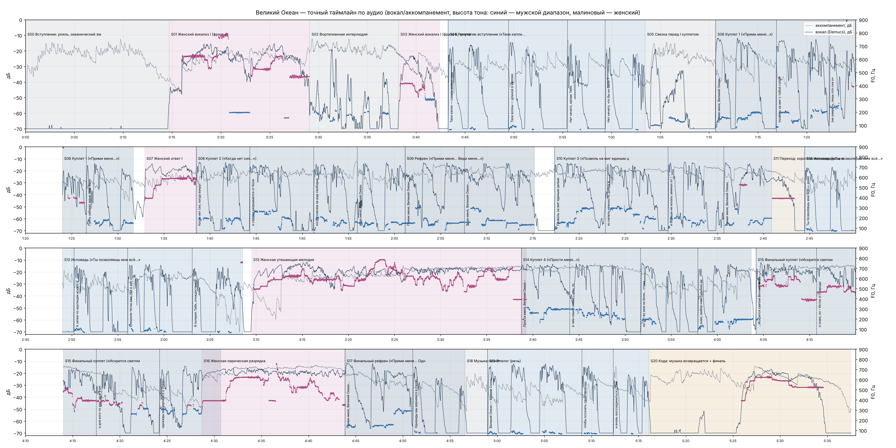

# Великий Океан — точный таймлайн по аудио

Источник: `Великий Океан — Тихое возвращение.mp3`, md5 `b51b9627990122a8a1ce1be18ebbc9e9`, контейнер 337.56 с, декодировано 337.52 с, 48 кГц стерео. Средний темп ≈72.8 BPM: Темп плавает 71-75 BPM (рубато), жёсткой сетки нет; для монтажа используем найденные доли (beats).

**Метод:** Demucs htdemucs (вокальная дорожка) → RMS-огибающая 10 мс + pYIN (высота тона) + Whisper large-v3 (пословные метки, проход без подсказок) → ручная сверка окон.

Все времена отсчитаны от первого декодированного сэмпла, то есть от t = 0 фильма. Точность границ — до 0,05 с там, где фразе предшествует тишина, и до 0,2–0,4 с внутри непрерывного пения или при наложении голосов (указано у каждой строки).

## Блоки

| ID | Начало | Конец | Длит. | Голос | Блок | Примечание |
|---|---|---|---|---|---|---|
| S00 | 0:00.00 | 0:14.70 | 14.70 с | none | Вступление: рояль, океанический эмбиент | Звук с первого сэмпла; голоса нет. |
| S01 | 0:14.70 | 0:29.10 | 14.40 с | female | Женский вокализ I (фраза А) | Тихий вход 14.70, полный голос 16.00. Слов нет. |
| S02 | 0:29.10 | 0:38.20 | 9.10 с | none | Фортепианная интерлюдия | Голоса нет (в стеме только призвуки инструментов). |
| S03 | 0:38.20 | 0:42.40 | 4.20 с | female | Женский вокализ I (фраза Б, затухание) | Затухает к 42.4; тишина вокала 42.45-43.25. |
| S04 | 0:43.27 | 1:03.45 | 20.18 с | male | Речитатив-вступление («Твои капли…») | Спокойная речь с паузами между фразами. |
| S05 | 1:03.45 | 1:10.66 | 7.21 с | none | Связка перед I куплетом | 64.0-67.5: низкая напевная фраза (виолончель или гул); слов нет — Whisper слов не нашёл. |
| S06 | 1:10.66 | 1:31.70 | 21.04 с | male | Куплет 1 («Прими меня…») | 84.1-86.4: высокий подголосок на строке в скобках. |
| S07 | 1:32.92 | 1:38.60 | 5.68 с | female | Женский ответ I | Перекрывается с началом куплета 2 (~98.5). |
| S08 | 1:38.50 | 2:01.15 | 22.65 с | male | Куплет 2 («Когда нет сил…») | Начало под хвостом женского ответа: ±0.4 с. |
| S09 | 2:01.15 | 2:15.20 | 14.05 с | male | Рефрен («Прими меня… Веди меня…») | В первом проходе Whisper его пропустил; подтверждено повторной проверкой окна 118.5-137. |
| S10 | 2:17.37 | 2:40.90 | 23.53 с | male | Куплет 3 («Позволь на миг единым целым стать…») |  |
| S11 | 2:40.90 | 2:44.48 | 3.58 с | female | Переход: короткая женская фраза и тишина | Женская фраза 160.97-163.38, тишина 163.45-164.45. «Инструментальная пауза» из текста длится ~3.6 с, а не десятки секунд. |
| S12 | 2:44.48 | 3:08.55 | 24.07 с | male | Исповедь («Ты позволяешь мне всё…») | Whisper ставил начало на 162.3 — на 2.2 с раньше; по энергии — 164.48. |
| S13 | 3:09.50 | 3:39.30 | 29.80 с | female | Женская утешающая мелодия | Длится под первой строкой куплета 4 до ~219.3. |
| S14 | 3:38.75 | 4:03.70 | 24.95 с | male | Куплет 4 («Прости меня…») |  |
| S15 | 4:04.20 | 4:30.70 | 26.50 с | male+female | Финальный куплет («Искрится светом…») + женский контрапункт | Женский контрапункт 244.62-260.26 местами громче мужского голоса. |
| S16 | 4:28.70 | 4:43.90 | 15.20 с | female | Женская лирическая разрядка | Начинается на последнем слове финального куплета. |
| S17 | 4:43.85 | 4:56.60 | 12.75 с | male | Финальный рефрен («Прими меня… Однажды мы вернёмся…») |  |
| S18 | 4:56.60 | 4:58.97 | 2.37 с | none | Музыка гаснет | Хвост аккорда; голоса нет. |
| S19 | 4:58.97 | 5:16.08 | 17.11 с | male | Эпилог (речь) | Фон гаснет до ~-40 дБ. Паузы: 307.25-308.97 и 310.65-312.28 (между «природу» и «и вновь» — см. расхождения). |
| S20 | 5:16.08 | 5:37.52 | 21.44 с | female | Кода: музыка возвращается + финальный женский вокализ | Рояль 316.0, бас ~318.5, женская нота 325.6-334.6, затухание 334.6-337.5. Этой коды нет в тексте («[Silence, end]»). |

## Строки (вокал имеет приоритет над текстом)

| Блок | Начало | Конец | ± с | Текст автора | Слышно (Whisper) | Примечание |
|---|---|---|---|---|---|---|
| S04 | 0:43.27 | 0:46.80 | 0.05 | Твои капли — сонмы живых существ. | Твои капли со мной живых существ | РАСХОЖДЕНИЕ: Whisper уверенно слышит «со мной» (p=0.98), а не «сонмы» (p=0.01 при подсказке). Похоже на ударение генератора; проверить на слух. |
| S04 | 0:49.47 | 0:52.75 | 0.05 | Твои волны — длиной в миллионы лет. | Твои волны длиной в миллионы лет |  |
| S04 | 0:55.48 | 0:57.05 | 0.05 | Нет ничего, кроме Тебя. | Нет ничего, кроме тебя |  |
| S04 | 0:59.35 | 1:03.45 | 0.05 | Нет ничего, что бы ни было Тобой. | Нет ничего, чтобы не было тобой | Внутри пауза 60.0-62.08 («Нет ничего,» / «что бы ни было Тобой»). Омофоны — не расхождение. |
| S06 | 1:10.66 | 1:15.15 | 0.05 | Прими меня, Великий Океан, | Прими меня, великий океан |  |
| S06 | 1:16.87 | 1:22.20 | 0.05 | позволь на миг с тобой соприкоснуться | Позволь на миг с тобой соприкоснуться |  |
| S06 | 1:22.28 | 1:26.45 | 0.1 | (не умереть, лишь ото сна очнуться). | Не умереть, лишь от осна очнуться | Высокий подголосок 84.1-86.4. |
| S06 | 1:26.58 | 1:31.70 | 0.1 | Пусть заберет меня твоя волна... | Пусть заберет меня твоя волна |  |
| S08 | 1:38.50 | 1:43.16 | 0.4 | Когда нет сил, когда вокруг обман, | Когда нет сил, когда вокруг обман | Начало под женским ответом. |
| S08 | 1:44.31 | 1:48.72 | 0.05 | и сердце разрывается от боли, | И сердце разрывается от боли |  |
| S08 | 1:51.24 | 1:54.81 | 0.05 | когда совсем не рад свободной воле – | Когда совсем не рад свободной воле |  |
| S08 | 1:55.95 | 2:01.15 | 0.05 | веди меня, Великий Океан. | Веди меня, великий океан |  |
| S09 | 2:01.15 | 2:07.50 | 0.3 | Прими меня, Великий Океан... | прими меня, Великий океан | Поётся без паузы сразу после куплета 2. |
| S09 | 2:07.56 | 2:15.20 | 0.3 | Веди меня, Великий Океан... | веди меня, Великий океан |  |
| S10 | 2:17.37 | 2:21.42 | 0.05 | Позволь на миг единым целым стать – | Позволь на миг единым целым стать |  |
| S10 | 2:22.85 | 2:28.40 | 0.1 | из капель нежности, добра и света, | Из капель нежности, добра и света |  |
| S10 | 2:29.65 | 2:33.60 | 0.05 | и больше не искать земных ответов, | И больше не искать земных ответов |  |
| S10 | 2:35.70 | 2:40.90 | 0.05 | прими меня, Великий Океан, | Прими меня, великий океан |  |
| S12 | 2:44.48 | 2:48.32 | 0.05 | Ты позволяешь мне всё — даже забыть Тебя. | Ты позволяешь мне все, даже забыть тебя |  |
| S12 | 2:50.25 | 2:54.30 | 0.05 | А затем по крупицам искать и собирать Тебя. | А затем по крупицам искать и собирать тебя |  |
| S12 | 2:56.05 | 3:00.84 | 0.05 | Слишком тесно там, где я забыл о Тебе и начал играть в себя. | Слишком тесно там, где я забыл о тебе и начал играть в себя |  |
| S12 | 3:03.07 | 3:08.55 | 0.05 | Я потерял Тебя, отождествившись с отражениями в твоих водах. | Я потерял тебя, отождествившись с отражениями в твоих водах |  |
| S14 | 3:38.75 | 3:43.90 | 0.2 | Прости меня, Великий Океан – | Прости меня, великий океан | Под хвостом женской мелодии. |
| S14 | 3:44.00 | 3:49.70 | 0.4 | в чем смысл искал – увы, то было пусто, | В чем смысл искал, увы, то было пусто |  |
| S14 | 3:51.68 | 3:56.55 | 0.05 | но нет во мне ни боли… страха… грусти – | но нет во мне ни боли, страха, грусти | Полный проход дал «страх, грусть»; в окне 227-243 без подсказки — «страха, грусти». Совпадает с текстом. |
| S14 | 3:57.88 | 4:03.70 | 0.05 | я знаю, выбор нам судьбою дан! | Я знаю, выбор нам судьбою дам | Конечное «н/м» неоднозначно (дам p=0.64 / дан p=0.52) — не расхождение. |
| S15 | 4:04.20 | 4:10.10 | 0.3 | …Искрится светом Вечный Океан, | Искрится светом вечный океан |  |
| S15 | 4:10.75 | 4:17.11 | 0.1 | я знаю, он – Исток и Прародитель, | Я знаю, он исток и прародитель |  |
| S15 | 4:17.50 | 4:22.82 | 0.2 | и для кого-то рок, но и учитель… | И для кого-то рок, но и учитель |  |
| S15 | 4:24.21 | 4:30.67 | 0.05 | однажды мы вернемся в Океан… | Однажды мы вернёмся в океан |  |
| S17 | 4:43.85 | 4:50.05 | 0.2 | Прими меня, Великий Океан... | Прими меня, великий океан |  |
| S17 | 4:51.05 | 4:56.60 | 0.05 | Однажды мы вернемся в Океан… | Однажды мы вернемся в океан |  |
| S19 | 4:58.97 | 5:07.25 | 0.03 | Великий Океан — единое Сознание, Душа, из которой вышли все живые существа для того, | Великий океан, единое сознание душа, из которой вышли все живые существа для того, |  |
| S19 | 5:08.97 | 5:10.65 | 0.03 | чтобы осознать свою природу | чтобы осознать свою природу |  |
| S19 | 5:12.28 | 5:16.08 | 0.03 | и вновь воссоединиться с Океаном. | и вновь воссоединиться с океаном. | РАСХОЖДЕНИЕ с ремаркой «без паузы между «природу» и «и вновь»»: в аудио пауза 1.63 с (310.65-312.28). Аудио не правим; в монтаже держим один непрерывный план через паузу. |

## Женский голос (доминирующая высота > 320 Гц) — моменты «ответа Океана»

14.70–29.07, 38.20–41.90, 84.07–86.43, 92.92–98.59, 157.39–158.24, 160.97–163.38, 189.50–219.33, 244.62–260.26, 268.72–283.95, 325.60–334.60

## Расхождения с черновиком и текстом

- Черновик: вступление 0:00-0:18 → факт: вступление с вокализом и интерлюдией длится до 0:42.4; речитатив 0:43.27-1:03.45.
- Черновик: куплет 1 0:37-0:58 → факт: 1:10.66-1:31.70.
- Черновик: рефрен 1:33-1:51 → факт: 2:01.15-2:15.20; поётся без паузы сразу после «веди меня, Великий Океан».
- Черновик: куплет 3 1:51-2:40 → факт: 2:17.37-2:40.90.
- Черновик: инструментальная пауза + исповедь 2:40-3:25 → факт: пауза всего ~3.6 с (2:40.9-2:44.5), исповедь 2:44.48-3:08.55.
- Черновик: утешающая мелодия 3:25-3:45 → факт: 3:09.50-3:39.30 (≈30 с).
- Черновик: куплет 4 3:45-4:22 → факт: 3:38.75-4:03.70; финальный куплет 4:04.20-4:30.70.
- Черновик: эпилог 5:33-5:37.56 → факт: 4:58.97-5:16.08 (17.1 с), после него кода 5:16.08-5:37.52 с финальной женской нотой 5:25.6-5:34.6.
- Текст: «сонмы живых существ» → на слух (Whisper) «со мной живых существ». Не исправляем, отмечаем.
- Ремарка: «без паузы между «природу» и «и вновь»» → в аудио пауза 1.63 с.
- Текст: «[Instrumental pause … then silence]» перед исповедью → фактически 3.6 с; «[Silence, end]» после эпилога → фактически 21 с коды.

## Файлы

- `TIMELINE.json` — блоки, строки, женские фразы, расхождения, доли (beats) для монтажа.
- `TIMELINE.csv` — то же плоской таблицей.
- `timeline_analysis.png` — график сверки: вокал и аккомпанемент (дБ), высота тона, границы блоков и строк.
