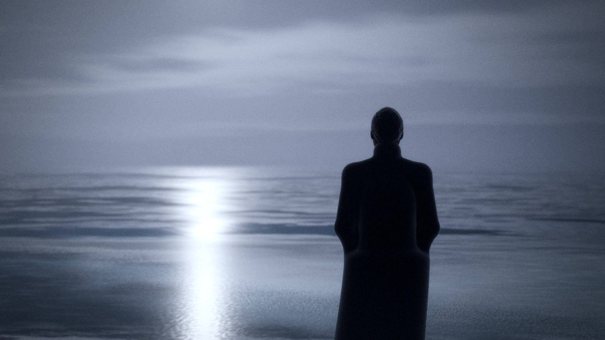

# Пакет генерации: первые 29 секунд (планы 01–04, кадры 0–698)

Последовательность событий, композиции и тайминг — как в утверждённом тесте. Отличается только способ получения изображения: фотореальные ключевые кадры → Image-to-Video → монтаж с оригинальным звуком.

| План | Таймкод | Кадров | Модель | Генерация | Ключевые кадры (layout) | Синхронизация |
|---|---|---|---|---|---|---|
| 01 | 0:00.00–0:07.25 | 174 | kling3pro | 8 с × 3 | first (`refs/layout/shot01_first.jpg`) | проявление 0–4,2 с (в монтаже); первые ноты рояля 0,21 с |
| 02 | 0:07.25–0:14.79 | 181 | kling4 | 9 с × 4 | first (`refs/layout/shot02_first.jpg`), last (`refs/layout/shot02_last.jpg`) | остановка героя до 14,79 с (вход голоса 14,70) |
| 03 | 0:14.79–0:23.00 | 197 | kling4 | 9 с × 4 | first (`refs/layout/shot03_first.jpg`), last (`refs/layout/shot03_last.jpg`) | луна выходит и загорается дорожка 15,2–18,6 с; пик на полном входе голоса 16,00 с |
| 04 | 0:23.00–0:29.12 | 147 | kling4 | 8 с × 4 | first (`refs/layout/shot04_first.jpg`), last (`refs/layout/shot04_last.jpg`) | вершина наката ≈26,4 с; откат к концу фразы 29,07 с |

Полные промпты ключевых кадров и движения — `SHOT_PROMPTS.md`, разделы 01–04.

## Порядок запуска (после вашего разрешения и появления ключа)

| Шаг | Команда | Стоимость | Контрольная точка |
|---|---|---|---|
| 1. Кастинг героя | `runway_gen.py refs --only hero_master --variants 8` и то же с `--img-model gemini_image3_pro` | $2,24 | вы выбираете героя → `work/i2v/approved/refs/hero_master.jpg` |
| 2. Референсы теста | `runway_gen.py refs --only hero_back,hero_walk,hero_profile,hero_hair_back,ocean_n1,ocean_n2,beach_night,swash_foam --variants 6` | $3,84 | утверждаем по одному на каждый ID |
| 3. Ключевые кадры | `runway_gen.py keys --shots 01-04 --variants 6` | $7,68 | выбираем кадры → `approved/keys/<план>_<first/last>.jpg` |
| 4. Видео | `runway_gen.py video --shots 01-04` | $22,43 | выбираем дубли → `approved/takes/<план>.mp4`, точки входа → `edl.json` |
| 5. A/B воды | `runway_gen.py video --shots 01,03 --takes 2 --model-override gen45` | $4,08 | сравнение Kling и Gen-4.5 |
| 6. Сборка | `conform.py --shots 01-04 --out out/photoreal_test_0000-0698.mp4` | $0 | проверки: кадры, 24 к/с, звук побитово |

Каждый платный шаг запускается с `--run --confirm --budget-usd 55`. Перед отправкой генератор сверяет журнал `work/i2v/ledger.json` и отказывается работать при превышении лимита.

## Чего ждать от результата

- Фотореальная вода, лунный свет, туман и ткань — сильная сторона Kling 4.0 и 3.0 Pro.
- Синхронизация: события внутри плана (выход луны, накат) модель ставит приблизительно. Точное попадание достигается выбором дубля, подрезкой и ретаймом до ±8 %. Склейки стоят точно на кадрах раскадровки.
- Если какой-то план не получится за 4 дубля, я предложу упрощение (например, разбить план на две склейки), не выходя за лимит.
